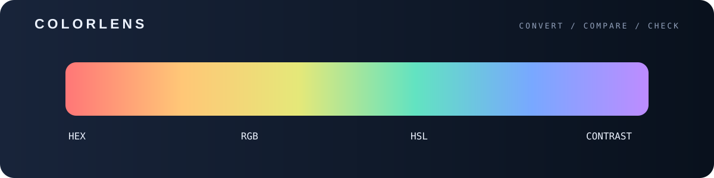
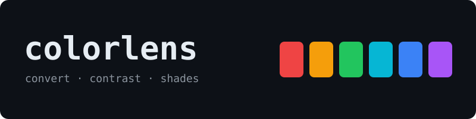

<p align="center">

<p align="center"></p>
  
</p>

**colorlens** is a tiny terminal color toolkit: convert between HEX, RGB and HSL, check WCAG contrast ratios, and generate shades with color swatches. One Python file, zero dependencies.

## Features

- Accepts `#rgb`, `#rrggbb`, `rgb(r, g, b)` and `hsl(h, s%, l%)`
- WCAG 2.x contrast checker (AA / AAA, normal and large text)
- `contrast` exits with code 1 when below AA, handy for CI and design tokens
- Shade generator, from light to dark
- True-color swatches in supported terminals (auto-disabled when piped)

## Install

No install needed. Requires Python 3.8+:

```bash
curl -O https://raw.githubusercontent.com/ERROR404DTIR/colorlens/main/colorlens.py
python3 colorlens.py --help
```

## Usage

> Quote values that start with `#` or contain spaces, otherwise your shell may treat them as comments or split them.

```bash
python3 colorlens.py show "#ff8800"
python3 colorlens.py show "hsl(32, 100%, 50%)"
python3 colorlens.py contrast 1a1a1a ffffff
python3 colorlens.py shades 3b82f6 -n 9
```

Example output of `contrast 1a1a1a ffffff`:

```text
#1a1a1a on #ffffff
ratio: 17.40:1
  AA normal text   PASS (needs 4.5:1)
  AA large text    PASS (needs 3.0:1)
  AAA normal text  PASS (needs 7.0:1)
  AAA large text   PASS (needs 4.5:1)
```

## Commands

| Command | Description |
| --- | --- |
| `show COLOR` | Print HEX, RGB, HSL and contrast on white/black |
| `contrast FG BG` | WCAG contrast ratio with pass/fail table |
| `shades COLOR [-n N]` | N shades from light to dark (default 9) |

## License

MIT